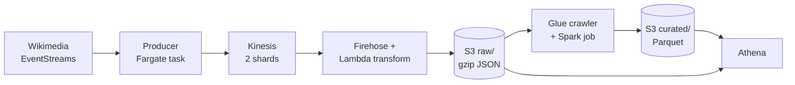

# wiki-stream-lake

A streaming and batch data lake on AWS, fed by the live stream of Wikipedia edits.

Wikimedia publishes every edit to every Wikipedia, Wikidata and Commons page as a public stream. This project captures it with a Python producer on ECS Fargate, moves it through Kinesis Data Streams and Firehose into S3, curates it into partitioned Parquet with a Glue Spark job, and queries it with Athena. Everything is Terraform, and four experiments measure the trade-offs.



## Findings

Measured results, with how each was measured, are in [docs/findings.md](docs/findings.md).

| Experiment | Question | Result |
|---|---|---|
| Hot shard | What does a skewed partition key do to Kinesis shards? | pending |
| JSON vs Parquet | How much less does Athena scan on partitioned Parquet? | pending |
| Replay | Does re-running the curate job create duplicates? | pending |
| Freshness | What does the Firehose buffer cost in delay, and save in file count? | pending |

## How it works

1. **Producer** (`src/producer/`): reads the Server-Sent Events stream, reconnecting and resuming from the last event ID; batches records into `PutRecords` calls, retrying only the records that fail; counts records per shard. It runs as a one-off Fargate task that stops itself when its time is up and writes a run summary to S3.
2. **Stream and delivery**: a 2-shard Kinesis Data Stream feeds Firehose, which writes gzip JSON to `raw/edits/`, partitioned by arrival hour.
3. **Transform Lambda** (`src/transform_lambda/`): drops canary and categorisation events, flattens each event to 16 fields, and replaces IP addresses and temporary-account names with `anonymous`, including inside titles and comments.
4. **Catalog and ETL** (`src/glue_jobs/`): a Glue workflow runs a crawler that registers `raw_edits`, then a Spark job that rebuilds each affected day of `curated_edits` as typed, deduplicated Snappy Parquet, partitioned by the date of the edit. Every run overwrites whole days, so re-running is safe.
5. **Query**: an Athena workgroup with a 1 GB scan limit per query, and saved queries from [`sql/`](sql/).

Design decisions and trade-offs: [docs/architecture.md](docs/architecture.md).

## Running it

Needs an AWS account, Terraform 1.6 or later, AWS CLI v2, Docker, and `uv` (which installs Python 3.12). The Spark tests also need Java.

```sh
make setup && make lint && make test

cp infra/terraform.tfvars.example infra/terraform.tfvars   # add the alert email
make apply        # everything, including the stream
make image        # build and push the producer image
make capture      # 12-hour capture on Fargate
# ...when the task has stopped:
make stream-down  # stop the stream's hourly charge
make run-etl      # crawl, then curate
```

The full routine, the experiments and fixes for common errors are in [docs/runbook.md](docs/runbook.md). `make help` lists every command.

## Cost

A 12-hour capture session, including the ETL, costs about $1. Only the Kinesis streams bill while idle, so they exist only during capture sessions. Everything else bills per use, and a $10 monthly budget sends alerts at 50, 80 and 100%.

## Repo layout

```text
infra/          Terraform: root module and storage, producer_task, streaming,
                replay_stream, catalog_etl, query and guardrails modules
src/producer/   SSE client, Kinesis writer, replay mode, Dockerfile
src/transform_lambda/   Firehose transformation function
src/glue_jobs/  curate_edits.py and its testable transforms
sql/            Athena saved queries
scripts/        helpers behind the make targets (tasks, benchmarks, freshness)
tests/          pytest, including local PySpark tests
docs/           architecture, runbook, findings, run summaries, benchmarks
```
