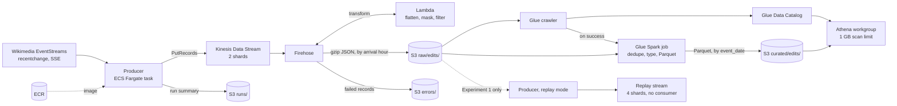

# Architecture

## Design decisions

### The producer is a one-off Fargate task

A capture runs for hours, which rules out Lambda (15-minute limit). An EC2 instance would bill while idle and need patching. A Fargate task started with `run-task` (no ECS service) runs for a fixed duration, stops itself and bills per second. It runs in the default VPC's public subnets with a public IP and a security group that allows only outbound HTTPS, so it needs no NAT gateway, which would cost more per month than the rest of the project.

The task has two IAM roles. The **execution role** is used by ECS to pull the image and write logs. The **task role** is used by the code: `PutRecords` on this project's streams, writes to `runs/`, and reads from `raw/edits/` for replays.

### Kinesis Data Streams in front of Firehose

Firehose could take records directly, but a Data Stream adds three things: 24 hours of retention, so records can be re-read; partition keys and shards, which Experiment 1 measures; and room for a second consumer later. The cost is the stream's per-shard-hour charge while it exists, so it is created only for capture sessions (`enable_streaming`).

### Cleaning happens before anything is stored

The Firehose transform Lambda drops canary events and categorisation events, flattens each event to 16 fields, and replaces IP addresses and temporary-account names with `anonymous`, in the user field and also inside titles and comments, where they appear in block logs and revert messages. Raw storage therefore never holds personal data. Records it cannot parse are returned as `ProcessingFailed` and land in `errors/` instead of failing the batch.

### Two zones, partitioned by different clocks

`raw/edits/` is partitioned by **arrival hour**, the only time Firehose knows. `curated/edits/` is partitioned by **event date**, the time queries ask about. The two do not line up at midnight, in both directions. An edit made at 23:59:58 can arrive at 00:00:03 and be filed under the next day. And Firehose names a file's partition by the time its buffer *started*, so a buffer opened at 23:59 that keeps filling until 00:01 files early edits from the new day under the previous one (1,209 edits on 24–25 October 2026). Rebuilding one event date therefore reads three days of raw (D-1, D, D+1) and keeps only the rows for D. Curated data is not also partitioned by wiki: that would split each day into hundreds of tiny files.

### Raw table crawled, curated table defined in code

The crawler discovers the raw schema and adds a partition for each new hour. The curated schema is fixed and owned by the job, so it is defined in Terraform with **partition projection**: Athena works out the `event_date` partitions from a date range, with no crawler or `MSCK REPAIR` needed.

### The curate job is idempotent

Every run, incremental or backfill, rebuilds whole `event_date` partitions from raw and writes them with Spark's dynamic partition overwrite, which replaces only the partitions being written. Incremental runs use **job bookmarks** only to find which dates have new data. Running the job twice gives the same table, which is what makes reprocessing after a bug safe (Experiment 3).

Glue reads JSON into DynamicFrames, which keep a column with mixed number types as a "choice". The job resolves these against the catalog's types before casting.

### Cost controls

| Control | Where |
|---|---|
| Streams exist only while needed | `enable_streaming`, `enable_replay_stream`, `make stream-down` |
| Capture tasks stop themselves; duration capped at 24 hours | producer |
| Glue job: 2 G.1X workers, 15-minute timeout, one run at a time | `catalog_etl` module |
| Athena: 1 GB scan limit per query, enforced workgroup settings | `query` module |
| Lifecycle rules: raw to Infrequent Access at 30 days, deleted at 90; errors at 14; Athena results at 7 | `storage` module |
| $10 monthly budget with alerts at 50, 80 and 100% | `guardrails` module |
| 7-day retention on every log group | each module |

## What would change for production

- **Terraform state** in an S3 backend with locking, not on one laptop.
- **On-demand Kinesis** or automatic resharding instead of a fixed 2 shards, plus CloudWatch alarms on iterator age and write throttling.
- **Private subnets with VPC endpoints** for the producer, if the account already pays for that networking.
- **KMS encryption** with customer-managed keys on the stream and buckets.
- **A long-running producer** (an ECS service with one task) with health checks, instead of fixed-length captures.
- **Data quality checks** in the curate job, such as row-count reconciliation between raw and curated, and alerts on `errors/`.
- **A table format such as Apache Iceberg** for curated data, to get atomic overwrites, schema evolution and time travel instead of plain Parquet folders.
- **Deployment from CI** with a plan on each pull request and an approval step before apply.
